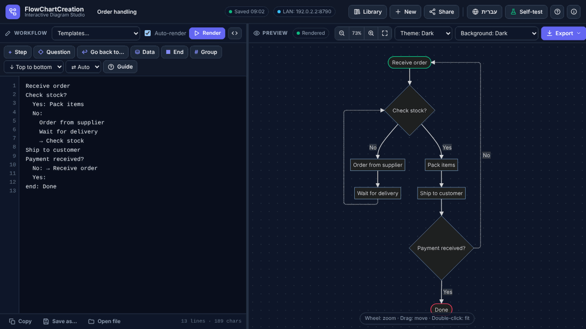
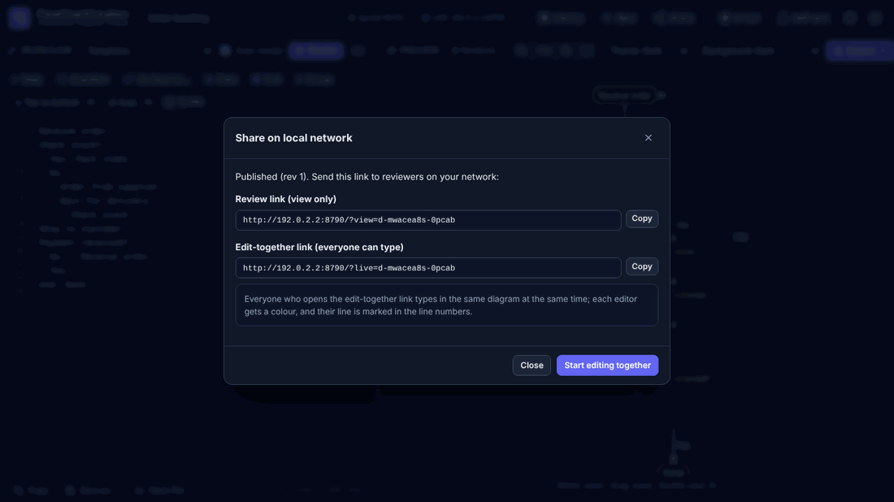
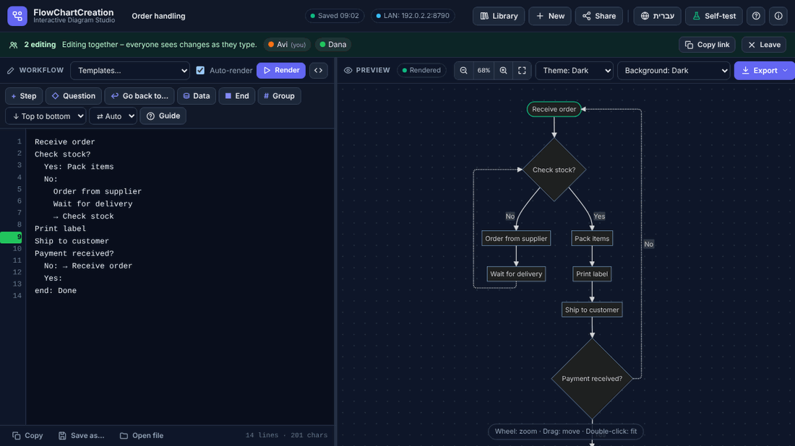

# FlowChartCreation 2.3.1

Workflow diagrams from plain text, in **Hebrew and English**. You write the process one step per line, and the diagram draws itself. Everything — the diagram engine (Mermaid 10.9.3) and the PDF library (jsPDF 2.5.2) — is inside **one HTML file**: no installation and no internet needed.

עברית: ראו `README_HE.md`.

---

## 1. Run it on your computer (no installation)

1. **Extract the whole ZIP** to a folder (right-click → *Extract All…*). Don't run the files from inside the ZIP.
2. **Check the files** (optional, 10 seconds): double-click `verify_files.bat` (Mac/Linux: `./verify_files.sh`). Every line should say **OK**.
3. **Double-click `FlowChartCreation.html`.** It opens in your browser (Chrome or Edge recommended; Firefox works too).
4. **Write your workflow** in the left panel — the diagram appears on the right. Click **Guide** for a cheat sheet, or pick a ready example under **Templates…**.
5. Your work is **saved automatically** in this browser (the header shows *Saved hh:mm*). Use **Library** to see all your diagrams, **Save as…** to keep a `.flowchart` file, and **Export** for PNG / PDF / SVG.



> Your library lives in the browser you use. Opening the file directly (`file://…`) and opening it through the server (`http://…`) keep **separate** libraries — use *Library → Backup all* / *Open file* to move diagrams between them or to another computer.

## 2. Share on your network for review (view only)

You need **Python 3** once, on the computer that shares (the "host"). The people who review need only a browser.

1. **Install Python 3** from <https://www.python.org/downloads/>. In the installer, tick **"Add python.exe to PATH"**, then *Install Now*. (Skip if Python is already installed.)
2. **Double-click `start_server.bat`** (Mac/Linux: `./start_server.sh`). A black window opens and shows addresses such as
   `On your network : http://192.168.1.20:8765`. Keep this window open while you share.
3. **Windows Firewall** may ask whether to allow Python. Tick **Private networks** and click **Allow access**. (Without this, others can't connect.)
4. Your browser opens the app from the server. Open (or write) your diagram and click **Share** → type your name → **OK**.
5. The Share window shows two links. **Copy the review link** (`…/?view=…`) and send it (email, Teams, chat) to people **on the same network**.
6. Reviewers click the link: they see the diagram read-only, and it **updates by itself** every time you click Share again. They can export it or *Copy to my library* to work on their own copy.
7. **To stop sharing**, close the black server window (or press **Ctrl+C** in it). Shared diagrams stay in the `shared_diagrams` folder for next time.



## 3. Edit together (everyone types at the same time)

1. Start the server and click **Share** as in section 2 (steps 1–4).
2. In the Share window, click **Start editing together**, or copy the **edit-together link** (`…/?live=…`) and send it to your colleagues.
3. Each person who opens the link is asked for their **name** once. A green bar shows who is editing, each with a colour; the line each person is on is marked in that colour in the line numbers.
4. Everyone types in the same diagram. Changes appear for the others within a moment, and simultaneous typing — even on the same line — is merged without losing anyone's text.
5. Changes are **saved on the server automatically** (about 1.5 seconds after the last keystroke) and also in each editor's own Library, with History.
6. Click **Leave** to stop. If the connection drops, a yellow bar says *reconnecting*; your changes are kept and sent when the connection returns.

Notes: while editing together, switching between simple text and Mermaid code is disabled, and the browser's Undo (Ctrl+Z) only covers your own typing since the last change from someone else. Everyone can also change the diagram name, direction and theme — those changes are shared too.



## 4. Outside the office network ("remotely")

The server is meant for a **trusted local network** (office LAN or Wi-Fi). It has **no login**, so **never open it to the internet** (no port forwarding on your router).

To work with someone outside the office, both sides should be on the same private network first:
- **Company VPN** — connect to the VPN, then use the normal links (ask IT which address to use if the one shown doesn't work).
- **A private-network tool** such as Tailscale or ZeroTier — install it on the host and on each colleague's computer, then replace the address in the link with the host's Tailscale/ZeroTier address (e.g. `http://100.64.1.5:8765/?live=…`).

Check your organisation's IT policy before installing such tools.

## 5. Put your name in the About window

The **ⓘ** button (top right) opens *About*: description, version, creator and contact.

1. Right-click `FlowChartCreation.html` → *Open with* → **Notepad**.
2. Near the top, find **`ABOUT – EDIT HERE`** and type your details between the quotes:
   `creator: "Dana Levi",`  `email: "dana@example.com",`  `organization: "Operations"`
3. **Save** (Notepad: *File → Save*; keep encoding **UTF-8**). Close Notepad.
4. Double-click **`update_checksums.bat`** (Mac/Linux: `./update_checksums.sh`) and answer **Y**. This records the edited file as correct, so `verify_files` keeps reporting OK.

## 6. Troubleshooting

| Problem | What to do |
|---|---|
| Blank page, or "This file is damaged" | The file was corrupted when copying/unzipping. Extract the ZIP again (*Extract All*) and run `verify_files.bat`. |
| `verify_files` says DAMAGED for the HTML after you edited the About block | Expected — run `update_checksums.bat` once after your own edits. |
| `start_server.bat` says *Python 3 was not found* | Install Python (section 2, step 1) with "Add python.exe to PATH", then close and reopen the window. |
| "Port 8765 is busy – using 8766" | Another program uses the port. Fine — use the new address shown. Or start with `py server.py --port 9000`. |
| Colleagues can't open the link | Allow Python in Windows Firewall for **Private** networks (Control Panel → Windows Defender Firewall → *Allow an app*). Make sure you're on the same network and the black window is still open. |
| The link stopped working the next day | The host's network address can change. Look at the address in the black window and send the new link. |
| "unknown host name" | Open the app with the address shown in the server window (an IP address like `http://192.168.1.20:8765`). To use a name instead (e.g. a DNS name or a VPN name), start the server with `py server.py --allow-host thatname`. |
| "Sharing needs the local server" | You opened the file directly. Open the `http://…` address that the server window shows. |
| A reviewer sees an old version | Click **Share** again — review links update within 4 seconds. |
| My diagrams disappeared | You're probably in the other library (file vs. server address, or another browser). Open the other one, or restore a *Backup all* file. |

Server options: `--port 9000` · `--read-only` (view only, no editing or publishing) · `--host 127.0.0.1` (this computer only) · `--data <folder>` · `--allow-host <name>` (an extra name for this computer in links).

**Built-in protection:** the server only accepts changes that come from the app's own pages, so other websites you visit can't add, change or delete shared diagrams; it only answers to IP addresses and this computer's own names (blocks "DNS rebinding" tricks); it can't be shown inside another site's frame; and it limits how many diagrams and connections it holds (1,000 shared diagrams, 200 live sessions), so it can't be flooded. There is still **no login** – anyone on your network who has the address can view and edit shared diagrams.

---

## Writing a workflow

```
Receive customer order            ← each line is a step; steps connect top to bottom
In stock?                         ← a line ending with "?" is a question
  Yes: Send to warehouse          ← indented "answer:" lines are the branches
  No:
    Create purchase order         ← several steps in an answer: indent further
    → In stock?                   ← "→" or "go to" goes back to an existing step
data: Update SQL Server           ← shape words: data:, end:, input:, sub:
end: Order completed
```

| Write | Result |
|---|---|
| a plain line | step (the first is drawn as the start oval, the last as the end oval) |
| line ending with `?` (or starting with `if` / `אם`) | question (diamond) |
| indented `Yes: …`, `No: …`, `Approved: …` | branches with that label on the arrow |
| `→ step`, `go to step`, `חזור ל…` | dashed arrow back (or forward) to an existing step |
| `end: …` / `סוף: …`, `data: …` / `נתונים: …`, `input: …` / `קלט: …`, `sub: …` | end, database, input/output, sub-process |
| `# Warehouse` | group / swim lane for the following lines (`#` alone ends it) |
| `// …` | comment (not drawn) |

**Loop arrows** ("go back to…") leave a box from the bottom, run along their own lane beside the diagram and enter the target box from the side; several loops get separate lanes, so arrows never pile up on each other.

**Hebrew:** when most of the text is Hebrew, the editor switches to right-to-left and right-aligned, a left-to-right flow becomes right-to-left, and the first answer is placed on the right. The **⇄ Auto / RTL / LTR** box next to the direction box lets you choose manually.

**Helpers:** the buttons above the text insert the right line with the right indentation. **Enter** keeps the indentation (one level deeper after a question); Enter on an empty line steps back. **Click a shape** to find its line. Mistakes are explained in plain words with a "did you mean…" suggestion. The `</>` button shows the generated Mermaid code (advanced).

## Features

- **Saving:** autosave with read-back verification, Library (Ctrl+O), History (20 snapshots per diagram), *Save as…* `.flowchart` files with your own file name, *Backup all*.
- **Export without losing data:** real text in the diagram, PNG 2×/3×/4×, PDF (exact size, A4/A3, or A4 real size over several pages), SVG, `.mmd`.
- **Mouse:** wheel zooms around the pointer, left-drag moves, double-click fits.
- **Self-test** (header): checks the compiler, arrow routing, right-to-left layout, rendering, exports, storage, and — through the server — sharing and live editing.

## Files

| File | Purpose |
|---|---|
| `FlowChartCreation.html` | The app. |
| `server.py` | Local-network server for review and editing together (Python 3.8+, standard library only — nothing to `pip install`). |
| `start_server.bat` / `.sh` | Start the server (Windows / Mac-Linux). |
| `verify_files.bat` / `.sh` | Check every file against `CHECKSUMS.sha256`. |
| `update_checksums.bat` / `.sh` | Record the current files as correct after your own edits (e.g. the About block). |
| `README.md`, `README_HE.md`, `docs/` | This guide (English / Hebrew) and its pictures. |
| `shared_diagrams/` | Created by the server: one JSON file per shared diagram, previous version as `.json.bak`, deleted ones in `_deleted/`. |

## Shortcuts

| Keys | Action |
|---|---|
| Ctrl+Enter | Render now |
| Ctrl+S / Ctrl+Shift+S | Save / Save as… |
| Ctrl+O | Library |
| Mouse wheel · left-drag · double-click | Zoom · move · fit |
| Tab / Shift+Tab | Indent / outdent |

## What's new in 2.3.1

- Arrow labels (Yes / No / …) are placed beside their line instead of on top of it.
- Security: changes from other websites are refused, unknown host names are refused (DNS rebinding), anti-framing headers, limits against flooding, and stricter checks on shared files.

## What's new in 2.3

- Loop arrows leave from the bottom and enter from the side, each on its own lane.
- Hebrew text switches the editor and the diagram to right-to-left (with an Auto / RTL / LTR choice).
- Edit together: several people type in the same diagram at the same time through the server.
- About window (ⓘ) with version, creator and contact; `update_checksums` scripts.
- This step-by-step guide, in English and Hebrew.

## License

MIT — see `LICENSE`. Bundled libraries: see `THIRD_PARTY_LICENSES.txt`.
