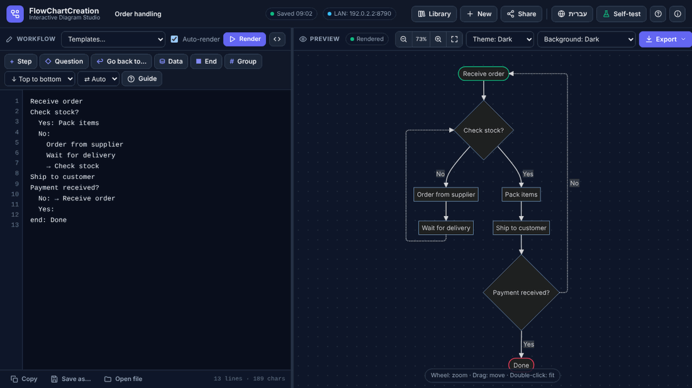
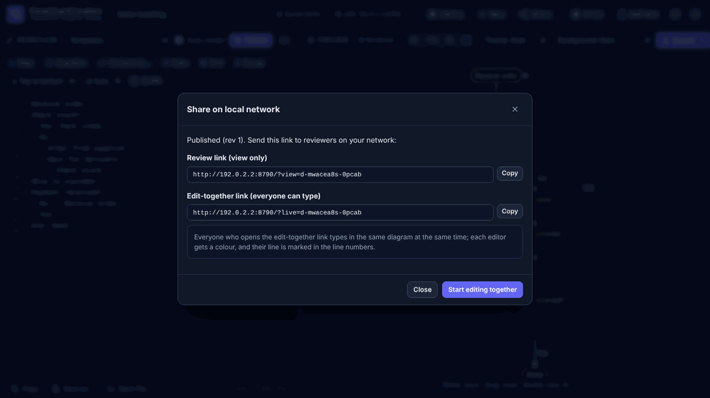
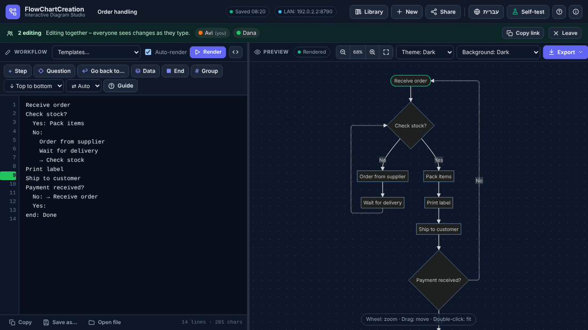
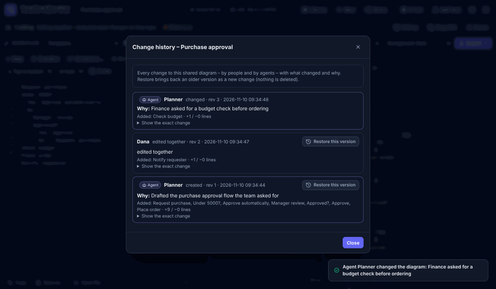
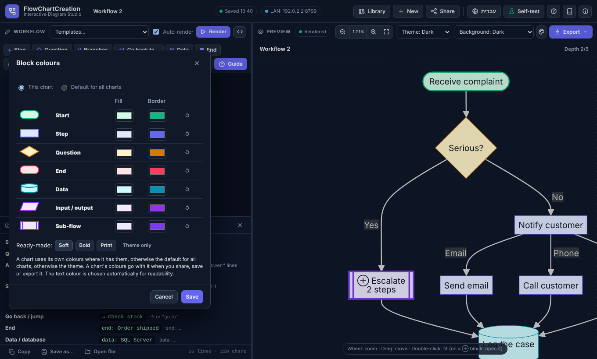
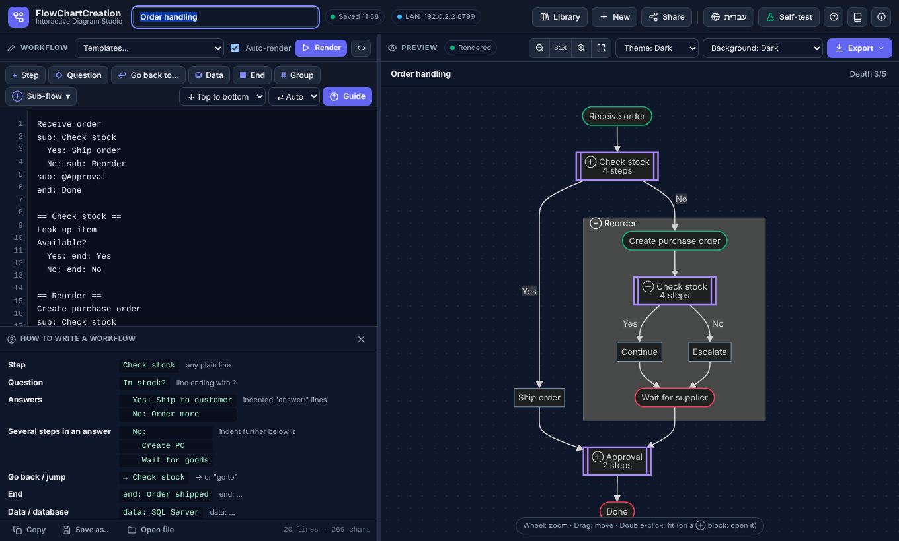

# FlowChartCreation 2.6 – מדריך למשתמש

תרשימי תהליך מטקסט פשוט, **בעברית ובאנגלית**. כותבים את התהליך שלב בכל שורה, והתרשים מצטייר מעצמו. הכול – מנוע התרשימים (Mermaid 10.9.3) וספריית ה-PDF‏ (jsPDF 2.5.2) – נמצא **בקובץ HTML אחד**: בלי התקנה ובלי אינטרנט.

אפשר לקרוא את המדריך הזה גם מתוך האפליקציה: כפתור **📖 מדריכים** בראש המסך. השפה נקבעת לפי שפת האפליקציה. English: [README.md](README.md).

---

## 1. הפעלה במחשב שלכם (בלי התקנה)

1. **חלצו את כל קובץ ה-ZIP** לתיקייה (קליק ימני ← *חלץ הכל…*). אל תפעילו את הקבצים מתוך ה-ZIP.
2. **בדיקת הקבצים** (רשות, 10 שניות): לחיצה כפולה על `verify_files.bat` (מק/לינוקס: `./verify_files.sh`). בכל שורה צריך להופיע **OK**.
3. **לחיצה כפולה על `FlowChartCreation.html`.** הקובץ נפתח בדפדפן (מומלץ Chrome או Edge; גם Firefox עובד).
4. **כתבו את התהליך** בחלונית הטקסט – התרשים מופיע לידה. לחצו **מדריך** לטבלת עזר קצרה, או בחרו דוגמה מוכנה תחת **תבניות…**.
5. העבודה **נשמרת אוטומטית** בדפדפן (בכותרת מופיע *נשמר hh:mm*). **ספרייה** מציגה את כל התרשימים, **שמירה בשם…** שומרת קובץ `.flowchart`, ו**ייצוא** יוצר PNG / PDF / SVG.



> הספרייה נשמרת בדפדפן שבו עובדים. פתיחת הקובץ ישירות (`file://…`) ופתיחה דרך השרת (`http://…`) הן **שתי ספריות נפרדות** – העבירו תרשימים ביניהן או למחשב אחר בעזרת *ספרייה ← גיבוי הכל* ו-*פתיחת קובץ*.

## 2. שיתוף ברשת לסקירה (צפייה בלבד)

צריך **Python 3** פעם אחת, רק במחשב שמשתף ("המארח"). הסוקרים צריכים רק דפדפן.

1. **התקינו Python 3** מ-<https://www.python.org/downloads/>. בחלון ההתקנה סמנו **"Add python.exe to PATH"** ולחצו *Install Now*. (אם Python כבר מותקן – דלגו.)
2. **לחיצה כפולה על `start_server.bat`** (מק/לינוקס: `./start_server.sh`). נפתח חלון שחור עם כתובות כמו
   `On your network : http://192.168.1.20:8765`. השאירו את החלון פתוח כל זמן השיתוף.
3. **חומת האש של Windows** עשויה לשאול אם לאפשר ל-Python גישה. סמנו **רשתות פרטיות (Private networks)** ולחצו **אפשר גישה**. בלי זה אחרים לא יוכלו להתחבר.
4. הדפדפן נפתח עם האפליקציה מהשרת. פתחו (או כתבו) תרשים ולחצו **שיתוף** ← הקלידו את שמכם ← **אישור**.
5. בחלון השיתוף יש שני קישורים. **העתיקו את קישור הסקירה** (`…/?view=…`) ושלחו אותו (מייל, Teams, צ'אט) לאנשים **באותה רשת**.
6. הסוקרים לוחצים על הקישור ורואים את התרשים לקריאה בלבד – והוא **מתעדכן מעצמו** בכל פעם שלוחצים שוב **שיתוף**. הם יכולים לייצא אותו או ללחוץ *העתקה לספרייה שלי* כדי לעבוד על עותק משלהם.
7. **להפסקת השיתוף** סגרו את החלון השחור (או Ctrl+C בתוכו). התרשימים המשותפים נשמרים בתיקייה `shared_diagrams` לפעם הבאה.



## 3. עריכה משותפת (כולם מקלידים באותו זמן)

1. הפעילו את השרת ולחצו **שיתוף** כמו בסעיף 2 (שלבים 1–4).
2. בחלון השיתוף לחצו **התחלת עריכה משותפת**, או העתיקו את **קישור העריכה המשותפת** (`…/?live=…`) ושלחו לעמיתים.
3. כל מי שפותח את הקישור מתבקש פעם אחת להקליד **שם**. פס ירוק מציג מי עורך, לכל אחד צבע; השורה שבה כל אחד נמצא מסומנת בצבע שלו במספרי השורות.
4. כולם מקלידים באותו תרשים. השינויים מופיעים אצל האחרים תוך רגע, והקלדה בו-זמנית – גם באותה שורה – מתמזגת בלי לאבד טקסט של אף אחד.
5. השינויים **נשמרים בשרת אוטומטית** (כשנייה וחצי אחרי ההקלדה האחרונה), וגם בספרייה של כל עורך, עם היסטוריה.
6. לחצו **יציאה** לסיום. אם החיבור נופל מופיע פס צהוב *מתחבר מחדש*; השינויים שלכם נשמרים ונשלחים כשהחיבור חוזר.

הערות: בזמן עריכה משותפת אי אפשר לעבור בין טקסט פשוט לקוד Mermaid, ו"בטל" (Ctrl+Z) של הדפדפן מכסה רק את ההקלדה שלכם מאז השינוי האחרון של מישהו אחר. כל אחד יכול גם לשנות את שם התרשים, הכיוון וערכת הצבעים – והשינויים משותפים לכולם.



## 4. מחוץ לרשת המשרדית ("מרחוק")

השרת מיועד ל**רשת מקומית מהימנה** (רשת המשרד או ה-Wi-Fi). **אין בו סיסמה**, ולכן **אל תפתחו אותו לאינטרנט** (בלי הפניית פורטים בראוטר).

כדי לעבוד עם מישהו מחוץ למשרד, שני הצדדים צריכים להיות קודם באותה רשת פרטית:

- **VPN ארגוני** – מתחברים ל-VPN ומשתמשים בקישורים הרגילים (אם הכתובת המוצגת לא עובדת, שאלו את מחלקת ה-IT באיזו כתובת להשתמש).
- **כלי רשת פרטית** כמו Tailscale או ZeroTier – מתקינים אצל המארח ואצל כל עמית, ומחליפים בקישור את הכתובת בכתובת ה-Tailscale/ZeroTier של המארח (למשל `http://100.64.1.5:8765/?live=…`).

בדקו את מדיניות ה-IT בארגון לפני התקנת כלים כאלה.

## 5. סוכנים (עוזרי AI מקומיים) שיוצרים תהליכים

סוכנים יכולים ליצור תרשימים חדשים ולשנות את אלה שהם יצרו; שינוי תרשימים אחרים דורש הרשאה מורחבת. לכל סוכן יש שם, וכל שינוי שלו נשמר ב**היסטוריה** עם מה השתנה ו**למה**.

1. הפעילו את השרת (סעיף 2).
2. במחשב השרת הריצו `agents.bat add "Planner"` ושמרו את המפתח שמודפס (למשל בקובץ `planner.key`).
3. בהגדרות ה-MCP של אפליקציית הסוכן הוסיפו את `fcc_mcp.py` עם כתובת השרת וקובץ המפתח (דוגמה: `mcp_config_example.json`).
4. בקשו מהסוכן תהליך. הוא יופיע ב**ספרייה ← משותף ברשת** עם שם הסוכן.
5. כדי לאפשר לו לשנות תרשים קיים: `agents.bat grant "Planner" <מזהה-תרשים>`. כדי לראות מה עשה: **היסטוריה** באפליקציה, או `agents.bat log "Planner"`.

הוראות מלאות: [מדריך הסוכנים](AGENT_GUIDE_HE.md) (גם בכפתור **📖 מדריכים** ← *מדריך סוכנים*).

## 6. היסטוריית שינויים (אנשים וסוכנים)

כל שינוי בתרשים משותף – פרסום, עריכה משותפת, שינויי סוכנים, שחזורים – נרשם: מי, מתי, מה השתנה (שלבים שנוספו/הוסרו, השורות המדויקות), ואצל סוכנים גם למה. פותחים בכפתור **היסטוריה** (ספרייה ← *משותף ברשת*, או בפס הסקירה / העריכה המשותפת). **שחזור הגרסה הזו** מחזיר גרסה קודמת כשינוי חדש; שום דבר לא נמחק. השרת שומר את 200 הגרסאות האחרונות של כל תרשים.



## 7. הוספת השם שלכם לחלון "אודות"

הכפתור **ⓘ** (למעלה) פותח את חלון *אודות*: תיאור, גרסה, יוצר ופרטי קשר.

1. קליק ימני על `FlowChartCreation.html` ← *פתח באמצעות* ← **Notepad**.
2. בראש הקובץ חפשו **`ABOUT – EDIT HERE`** והקלידו את הפרטים בין המירכאות:
   `creator: "דנה לוי",`  `email: "dana@example.com",`  `organization: "תפעול"`
3. **שמרו** (*קובץ ← שמירה*; קידוד **UTF-8**) וסגרו את Notepad.
4. לחיצה כפולה על **`update_checksums.bat`** (מק/לינוקס: `./update_checksums.sh`) וענו **Y**. כך הקובץ הערוך נרשם כתקין, ו-`verify_files` ימשיך להציג OK.

## 8. פתרון בעיות

| בעיה | מה עושים |
|---|---|
| דף ריק, או "הקובץ פגום" | הקובץ נפגם בהעתקה או בחילוץ. חלצו שוב את ה-ZIP (*חלץ הכל*) והריצו `verify_files.bat`. |
| `verify_files` מציג DAMAGED ל-HTML אחרי עריכת "אודות" | צפוי – הריצו פעם אחת `update_checksums.bat` אחרי עריכה שלכם. |
| `start_server.bat` כותב *Python 3 was not found* | התקינו Python (סעיף 2, שלב 1) עם "Add python.exe to PATH", וסגרו ופתחו שוב את החלון. |
| "Port 8765 is busy – using 8766" | תוכנה אחרת משתמשת בפורט. זה בסדר – השתמשו בכתובת החדשה שמוצגת, או הפעילו עם `py server.py --port 9000`. |
| עמיתים לא מצליחים לפתוח את הקישור | אפשרו ל-Python גישה בחומת האש עבור רשתות **פרטיות** (לוח הבקרה ← חומת האש של Windows Defender ← *אפשר יישום*). ודאו שאתם באותה רשת ושהחלון השחור עדיין פתוח. |
| הקישור הפסיק לעבוד למחרת | כתובת הרשת של המחשב המארח יכולה להשתנות. בדקו את הכתובת בחלון השחור ושלחו קישור חדש. |
| סוכן מקבל "no permission" | הוא רשאי לשנות רק תרשימים שהוא יצר. הריצו `agents.bat grant "Name" <מזהה-תרשים>` (או `all`). |
| סוכן מקבל "unknown or missing agent key" | בדקו את נתיב קובץ המפתח בהגדרות ה-MCP של אפליקציית הסוכן; `agents.bat newkey "Name"` יוצר מפתח חדש. |
| "unknown host name" | פתחו את האפליקציה בכתובת שמוצגת בחלון השרת (כתובת IP כמו `http://192.168.1.20:8765`). כדי להשתמש בשם (למשל שם DNS או שם VPN), הפעילו את השרת עם `py server.py --allow-host השם`. |
| "שיתוף דורש את השרת המקומי" | פתחתם את הקובץ ישירות. פתחו את כתובת ה-`http://…` שמוצגת בחלון השרת. |
| סוקר רואה גרסה ישנה | לחצו שוב **שיתוף** – קישורי סקירה מתעדכנים תוך 4 שניות. |
| התרשימים שלי נעלמו | כנראה אתם בספרייה האחרת (קובץ מול כתובת שרת, או דפדפן אחר). פתחו את השנייה, או שחזרו קובץ *גיבוי הכל*. |

אפשרויות השרת: `--port 9000` · `--read-only` (צפייה בלבד, בלי עריכה או פרסום) · `--host 127.0.0.1` (המחשב הזה בלבד) · `--data <תיקייה>` · `--allow-host <שם>` (שם נוסף למחשב הזה בקישורים).

**הגנות מובנות:** השרת מקבל שינויים רק מהעמודים של האפליקציה עצמה, כך שאתרים אחרים שגולשים אליהם לא יכולים להוסיף, לשנות או למחוק תרשימים משותפים; הוא עונה רק לכתובות IP ולשמות של המחשב הזה (חוסם תרגילי "DNS rebinding"); אי אפשר להציג אותו בתוך מסגרת של אתר אחר; ויש מגבלה על מספר התרשימים והחיבורים (1,000 תרשימים משותפים, 200 עריכות משותפות פעילות) כדי שלא יוצף. עדיין **אין סיסמה** – כל מי שברשת ויודע את הכתובת יכול לצפות בתרשימים משותפים ולערוך אותם.

---

## כתיבת תהליך

```
קבלת הזמנה מלקוח               ← כל שורה היא שלב; השלבים מתחברים מלמעלה למטה
יש במלאי?                       ← שורה שמסתיימת ב-? היא שאלה
  כן: שליחה למחסן               ← שורות מוזחות עם "תשובה:" הן הענפים
  לא:
    הזמנת רכש                   ← כמה שלבים בתשובה: הזחה נוספת
    חזור ליש במלאי              ← "חזור ל…" או → חוזר לשלב קיים
נתונים: עדכון SQL Server        ← מילות צורה: נתונים:, סוף:, קלט:, תת תהליך:
סוף: ההזמנה הושלמה
```

| כותבים | מקבלים |
|---|---|
| שורה רגילה | שלב (הראשון מצויר כאליפסת התחלה, האחרון כאליפסת סיום) |
| שורה שמסתיימת ב-`?` (או מתחילה ב-`אם` / `if`) | שאלה (מעוין) |
| שורות מוזחות `כן: …`, `לא: …`, `אושר: …` | ענפים, עם התווית על החץ |
| שלב עם שורות מוזחות מתחתיו (`מייל: …`, `SMS`) | ענפים מהשלב – עץ, בלי שאלה (תווית אופציונלית) |
| `חזור ל…`, `→ שלב`, `go to …` | חץ מקווקו חזרה (או קדימה) לשלב קיים |
| `סוף: …` / `end: …`, `נתונים: …` / `data: …`, `קלט: …` / `input: …` | סיום, מסד נתונים, קלט/פלט |
| `תת-תהליך: שם` + `== שם ==`, או `תת-תהליך: @שם` | בלוק תת-תהליך (ראו *תתי-תהליכים* בהמשך) |
| `# מחסן` | קבוצה / מסלול שחייה לשורות שאחריה (`#` לבד מסיים) |
| `// …` | הערה (לא מצוירת) |

**ענפים בלי שאלה (עצים):** מזיחים כמה שורות מתחת לשלב רגיל וכל אחת הופכת לענף ממנו. תווית היא אופציונלית (`מייל: שליחת מייל` שם "מייל" על החץ). כמו תשובות, הענפים מתחברים מחדש בשורה הבאה עם הזחה קטנה יותר; ענף שמסתיים ב-`סוף:` נעצר שם.

```
יידוע הלקוח
  מייל: שליחת מייל
  טלפון: שיחה עם הלקוח
  SMS                             ← בלי תווית
תיעוד הפנייה                       ← שלושת הענפים מתחברים כאן
```

(שלבים שנכתבים מתחת לתשובה עם טקסט באותה שורה – `כן: שליחה` עם `אריזה`, `תווית` מוזחים מתחתיה – עדיין רצים אחד אחרי השני, כמו קודם. הכפתור **⑂ ענפים** מוסיף דוגמה מוכנה.)

**צבעי בלוקים:** כפתור הפלטה (🎨) ליד *רקע* בוחר צבע מילוי ומסגרת לכל סוג בלוק – התחלה, שלב, שאלה, סיום, נתונים, קלט/פלט, תת-תהליך. בוחרים **התרשים הזה** או **ברירת מחדל לכל התרשימים**; תרשים משתמש בצבעים שלו, אחר כך בברירת המחדל, אחר כך בעיצוב. ערכות מוכנות: *רך*, *בולט*, *הדפסה*. צבע הטקסט נבחר אוטומטית כדי שיישאר קריא. הצבעים עוברים עם התרשים בשיתוף, בשמירה ובייצוא (PNG, ‏PDF, ‏SVG וקוד ה-`.mmd`). הם חלים על תרשימים בטקסט תהליך; תרשימים בקוד Mermaid משתמשים ב-`classDef`.



**חצי חזרה** ("חזור ל…") יוצאים מתחתית הצורה, עוברים במסלול משלהם לצד התרשים ונכנסים לצורת היעד מהצד; לכל לולאה מסלול נפרד, כך שהחצים לא נערמים זה על זה. **תוויות החצים** (כן / לא) ממוקמות ליד הקו ולא עליו.

**עברית:** כשרוב הטקסט בעברית, העורך עובר לימין-לשמאל ומיושר לימין, זרימה משמאל לימין הופכת לימין-לשמאל, והתשובה הראשונה ממוקמת מימין. התיבה **⇄ אוטומטי / ימין-שמאל / שמאל-ימין** ליד תיבת הכיוון מאפשרת לבחור ידנית.

**עזרים:** הכפתורים מעל הטקסט מוסיפים את השורה הנכונה עם ההזחה הנכונה. **Enter** שומר על ההזחה (רמה אחת פנימה אחרי שאלה); Enter על שורה ריקה חוזר רמה אחורה. **לחיצה על צורה** מסמנת את השורה שלה. טעויות מוסברות במילים פשוטות עם הצעה "התכוונתם ל…". הכפתור `</>` מציג את קוד ה-Mermaid שנוצר (למתקדמים).

## תתי-תהליכים (בלוק עם תהליך פנימי משלו)

תת-תהליך מאפשר להציג את התהליך ברמה גבוהה ולשמור את הפרטים בתוך בלוק. הבלוק מצויר במסגרת כפולה עם **⊕**, עם השם שלו ומספר השלבים שבתוכו.



```
קבלת הזמנה
תת-תהליך: בדיקת מלאי              ← בלוק; התהליך הפנימי שלו הוא הקטע למטה
  כן: שליחה ללקוח                 ← לתת-התהליך שתי יציאות, ולכן תשובה לכל יציאה
  לא: תת-תהליך: הזמנה מחדש
סוף: הסתיים

== בדיקת מלאי ==                  ← תת-תהליך מקומי: קטע בסוף אותו טקסט
חיפוש פריט
יש במלאי?
  כן: סוף: כן                     ← שורות סוף: הן היציאות של תת-התהליך
  לא: סוף: לא

== הזמנה מחדש ==
הזמנת רכש
המתנה לספק
```

**שני סוגים – בוחרים בכל פעם שיוצרים:**

| סוג | איך כותבים | איפה הוא נשמר |
|---|---|---|
| **מקומי** | `תת-תהליך: שם` + קטע `== שם ==` | רק בתוך התרשים הזה |
| **משותף** | `תת-תהליך: @שם` | תרשים נפרד שתרשימים אחרים יכולים לשלב (בספרייה שלכם, ובשרת כשמשתפים) |

**יצירה:** הכפתור **⊕ תת-תהליך ▾** מעל הטקסט: *תת-תהליך חדש*, *העברת השורות המסומנות לתת-תהליך* (מסמנים קודם את השלבים) ו*קישור תת-תהליך משותף*. כל אחת שואלת אם לשמור כמקומי או כמשותף.

**איך תת-תהליך מתחבר:** **השלב הראשון** שלו הוא נקודת הכניסה; **שורות סוף:** הן היציאות. עם יציאה אחת התהליך הראשי פשוט ממשיך; עם כמה יציאות הבלוק מתנהג כמו שאלה – כותבים מתחתיו תשובה לכל יציאה (השמות חייבים להתאים). חצים לא קופצים בין רמות.

**צפייה:**
- **לחיצה כפולה** על בלוק ⊕ פותחת אותו; **סרגל הנתיב** מעל התרשים (*תרשים › בדיקת מלאי*) והכפתור **חזרה** מחזירים למעלה. פתיחת תת-תהליך משותף פותחת את התרשים שלו.
- **לחיצה** על בלוק מציעה *פתיחה* / *הרחבה במקום* – *הרחבה במקום* מציגה את התהליך הפנימי במקומו, בתוך מסגרת (לחיצה על אזור כותרת המסגרת מכווצת).
- בעריכה משותפת, כל אחד מנווט בעצמו.

**עומק:** תתי-תהליכים בתוך תתי-תהליכים זה בסדר. המגבלה היא 5 רמות לתרשים; כשמקשרים תת-תהליך עמוק יותר המגבלה עולה אוטומטית (תופיע הודעה), עד 20. הכפתור **עומק n/5** בסרגל הנתיב משנה אותה. תת-תהליך אף פעם לא יכול להשתמש בעצמו, ישירות או דרך אחרים – זה נחסם, עם הצגת הלולאה.

**תתי-תהליכים משותפים ושינויים:**
- שינוי בתת-תהליך משותף נראה בכל התרשימים שמשתמשים בו. בתרשימים האלה מופיע סרגל: **אישור**, או **שמירת הגרסה הקודמת** – שמעתיקה את הגרסה הישנה לתת-תהליך חדש (מקומי או משותף, לבחירתכם). ההחלטה נרשמת בתרשים.
- כשפותחים תת-תהליך משותף שאחרים משתמשים בו, סרגל הנתיב מציג **בשימוש ב-N תרשימים אחרים**.
- אי אפשר למחוק מהשרת תת-תהליך משותף שנמצא בשימוש.
- **שיתוף**, **שמירה בשם…** ו**גיבוי הכל** לוקחים את תתי-התהליכים יחד עם התרשים.

**ייצוא** (תפריט ייצוא ← *תתי-תהליכים*): **כפי שמוצג** (מה שרואים), **הכול מורחב** (כל תתי-התהליכים המקומיים פתוחים במקומם), או **עמוד לכל אחד (PDF)** – התרשים, וכל תת-תהליך בעמוד משלו עם הנתיב שלו ככותרת; תת-תהליך שמשמש בכמה מקומות מודפס פעם אחת, עם "בשימוש ב".

**קוד Mermaid** (`</>`) מציג כל תת-תהליך כבלוק, עם השם שלו בהערה (`%% sub-flow: בדיקת מלאי`).

## יכולות

- **שמירה:** שמירה אוטומטית עם בדיקת קריאה חוזרת, ספרייה (Ctrl+O), היסטוריה (20 גרסאות לכל תרשים), *שמירה בשם…* לקובצי `.flowchart` בשם שתבחרו, *גיבוי הכל*.
- **ייצוא בלי אובדן מידע:** טקסט אמיתי בתרשים, PNG ‏2×/3×/4×, PDF (גודל מדויק, A4/A3, או גודל אמיתי על כמה דפי A4), SVG, ‏`.mmd`.
- **עכבר:** גלגלת מגדילה ומקטינה סביב הסמן, גרירה בלחצן שמאלי מזיזה, לחיצה כפולה מתאימה לחלון (על בלוק ⊕: פותחת את תת-התהליך).
- **בדיקה עצמית** (בכותרת): בודקת את המהדר, תתי-התהליכים, הענפים, צבעי הבלוקים, ניתוב החצים, פריסה מימין לשמאל, ציור, ייצוא, אחסון, ודרך השרת – גם שיתוף, עריכה משותפת והיסטוריה.

## קבצים

| קובץ | תפקיד |
|---|---|
| `FlowChartCreation.html` | האפליקציה. |
| `server.py` | שרת הרשת המקומית לסקירה ולעריכה משותפת (Python 3.8 ומעלה, ספרייה סטנדרטית בלבד – אין מה להתקין ב-pip). |
| `start_server.bat` / `.sh` | הפעלת השרת (ווינדוס / מק-לינוקס). |
| `verify_files.bat` / `.sh` | בדיקת כל קובץ מול `CHECKSUMS.sha256`. |
| `update_checksums.bat` / `.sh` | רישום הקבצים הנוכחיים כתקינים אחרי עריכה שלכם (למשל חלון "אודות"). |
| `workflow_text.py` | בודק טקסט התהליך של השרת (אותם כללים כמו באפליקציה). |
| `fcc_mcp.py`, `mcp_config_example.json` | מחבר MCP לסוכנים, ודוגמת הגדרה. |
| `agents.bat` / `.sh`, `AGENT_GUIDE.md`, `AGENT_GUIDE_HE.md` | ניהול סוכנים (הוספה, הרשאה, יומן …) ומדריך הסוכנים (אנגלית / עברית). |
| `README.md`, `README_HE.md`, `docs/` | המדריך הזה (אנגלית / עברית) והתמונות שלו. |
| `shared_diagrams/` | נוצרת על ידי השרת: קובץ JSON לכל תרשים משותף, הגרסה הקודמת כ-`.json.bak`, היסטוריה ב-`_audit/` ו-`_versions/`, תרשימים שנמחקו ב-`_deleted/`. |

## קיצורי מקלדת

| מקשים | פעולה |
|---|---|
| Ctrl+Enter | ציור מיידי |
| Ctrl+S / Ctrl+Shift+S | שמירה / שמירה בשם… |
| Ctrl+O | ספרייה |
| גלגלת · גרירה · לחיצה כפולה | זום · הזזה · התאמה לחלון |
| Tab / Shift+Tab | הזחה פנימה / החוצה |

## מה חדש בגרסה 2.6

- **ענפים בלי שאלה:** שורות מוזחות מתחת לשלב רגיל הופכות לענפים (עצים), עם תוויות אופציונליות; הם מתחברים מחדש כמו תשובות. כפתור חדש **⑂ ענפים**.
- **צבעי בלוקים:** מילוי ומסגרת לכל סוג בלוק, לתרשים הזה או כברירת מחדל לכל התרשימים; ערכות מוכנות; טקסט קריא; הצבעים עוברים בשיתוף, בשמירה, בעריכה משותפת ובייצוא.

## מה חדש בגרסה 2.5

- **תתי-תהליכים:** בלוקים עם תהליך פנימי משלהם – מקומיים (קטע `== שם ==`) או משותפים (`תת-תהליך: @שם`, לשימוש חוזר בתרשימים אחרים). לחיצה כפולה לפתיחה, *הרחבה במקום*, סרגל נתיב וחזרה.
- כמה יציאות מתנהגות כמו שאלה; מגבלת עומק לכל תרשים (עולה אוטומטית עד 20); לולאות בין תתי-תהליכים נחסמות.
- שינויים בתת-תהליך משותף: **אישור** או **שמירת הגרסה הקודמת**; אי אפשר למחוק תת-תהליך שבשימוש; שיתוף / שמירה בשם / גיבוי לוקחים את תתי-התהליכים.
- ייצוא: כפי שמוצג, הכול מורחב, או עמוד PDF לכל תת-תהליך.
- גם השרת בודק תתי-תהליכים (והוא הקובע); האפליקציה משווה את הבדיקה שלה לבדיקת השרת ומזהירה אם יש הבדל.

## מה חדש בגרסה 2.4

- **סוכנים:** עוזרי AI מקומיים יוצרים ומשנים תהליכים דרך מחבר ה-MCP, כל אחד עם שם ומפתח משלו. תרשימים חדשים ושלהם בלבד; אחרים דורשים הרשאה מורחבת.
- **היסטוריית שינויים** לכל תרשים משותף (אנשים וסוכנים): מי, מתי, מה ולמה, עם **שחזור**.
- השרת בודק את טקסט התהליך בעצמו (אותם כללים והודעות כמו באפליקציה).
- שינויים של אנשים חייבים להגיע מהאפליקציה; תוכנות משתמשות בממשק הסוכנים עם מפתח.
- **מדריכים בתוך האפליקציה** (📖), בעברית ובאנגלית לפי שפת האפליקציה.

## מה חדש בגרסה 2.3.1

- תוויות על החצים (כן / לא / …) ממוקמות ליד הקו ולא עליו.
- אבטחה: שינויים מאתרים אחרים נחסמים, שמות שרת לא מוכרים נחסמים, הגנה מפני הצגה במסגרת, מגבלות נגד הצפה ובדיקות קפדניות לקבצים משותפים.

## מה חדש בגרסה 2.3

- חצי חזרה יוצאים מלמטה ונכנסים מהצד, כל אחד במסלול משלו.
- טקסט בעברית מעביר את העורך ואת התרשים לימין-לשמאל (עם בחירה אוטומטי / ימין-שמאל / שמאל-ימין).
- עריכה משותפת: כמה אנשים מקלידים באותו תרשים באותו זמן דרך השרת.
- חלון "אודות" (ⓘ) עם גרסה, יוצר ופרטי קשר; סקריפטים `update_checksums`.
- המדריך הזה, צעד אחר צעד, בעברית ובאנגלית.

## רישיון

MIT – ראו `LICENSE`. ספריות מצורפות: ראו `THIRD_PARTY_LICENSES.txt`.
